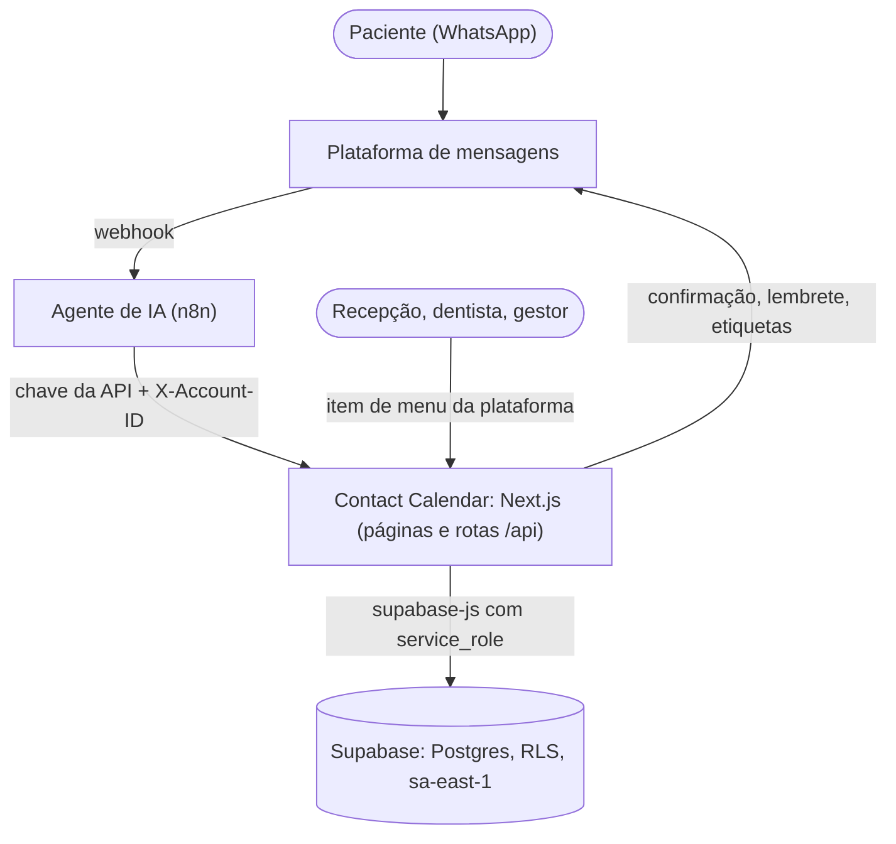

# Contact Calendar

Agenda odontológica white label, multi clínica, com API para o agente de IA.

A recepção, os dentistas e o gestor usam a interface; o agente de IA do
WhatsApp usa as rotas `/api/v1/agente/*`. Os dois passam pelas mesmas regras e
enxergam os mesmos horários livres. A documentação da API fica em `/api/docs`.

> **Em migração para a arquitetura do CRM ContactIA**, como app próprio ligado ao
> CRM pela API ([ADR 0001](docs/adr/0001-app-proprio-com-a-arquitetura-do-crm.md),
> [plano](docs/migracao-para-a-arquitetura-do-crm.md)). O código novo convive com
> o antigo até o corte; este README descreve os dois. O funil de leads não mora
> mais aqui: a camada que espelhava o painel nativo da plataforma saiu em outubro
> de 2026.

## Visão geral



- **Um app Next.js 16** (App Router, React 19, TypeScript, Tailwind 4, Radix, zod),
  publicado na Vercel.
- **Páginas** em `src/app/(agenda)/*`, componentes de cliente que chamam a API v1
  com o token da sessão (fase 6).
- **Rotas** da API v1 em `src/api/v1`, entregues ao Hono por
  `src/app/api/[[...rota]]`. Das antigas, só ficaram as do onboarding público,
  que gravam no Supabase antigo pelo cliente com `service_role`.
- **Regras no banco:** horários livres (`get_available_slots`), conflito
  (`check_appointment_conflict`), busca sem acento e telefone
  (`find_patients_by_phone`), e as restrições `EXCLUDE` que impedem duas
  consultas no mesmo horário.
- **O card no CRM:** agendar, remarcar, cancelar, a falta e a chegada gravam um
  aviso na caixa de saída, na mesma transação da consulta, e o worker entrega pela
  API do CRM (`src/modulos/crm`), com novas tentativas. O card mostra a próxima
  consulta ativa do telefone.
- **O que o CRM marca fora da agenda** (a CRC na Clinicorp, o botão, a IA) chega
  pelo webhook do CRM, que a agenda cadastra ao ligar a clínica
  (`POST /api/v1/crm/avisos`, com a assinatura conferida). O worker lê o card e
  encaixa a consulta sozinho quando o dentista, a unidade e o procedimento das
  vindas estão ligados; senão, ela espera na lista "Vindas do CRM". A consulta
  ligada ao card acompanha a data, o cancelamento, a falta e o comparecimento.
- **Mensagens:** as rotas antigas mandavam a confirmação e o lembrete e
  etiquetavam o contato na plataforma. Elas saíram em outubro de 2026; as
  mensagens voltam na fase 7, pela caixa de saída e pelo CRM.

## Acesso

| Quem | Como entra | Validade |
|---|---|---|
| Recepção, dentista, gestor | O item de menu da plataforma abre `/?companyId={{companyId}}&userId={{userId}}`, como no CRM. A agenda confere a origem (`EMBED_HOSTS`), acha a clínica pelo `companyId` e o usuário vinculado em `agenda.usuarios`, e dá um token assinado (`AGENDA_SEGREDO_SESSAO`) que fica na aba e vai no cabeçalho `X-Agenda-Sessao` | 12 horas |
| Agente de IA e integrações | `Authorization: Bearer agd_...` na API nova (`/api/v1`), com a chave da tabela `agenda.chaves_api` | Até a chave ser revogada |

- As chaves ficam com hash sha256, como no CRM; o texto nunca é gravado.
- Toda consulta ao banco filtra por `account_id`; o RLS fica ligado sem
  políticas, como segunda barreira.
- **As telas usam o login pelo item de menu** (fase 6 da migração). Os papéis
  são relidos do banco a cada pedido, e `GET /api/v1/eu` dá o usuário, os papéis,
  o fuso e a cadência da clínica. Quem cadastra os usuários da agenda fica para a
  fase 8; até lá, eles entram no banco à mão (ou pelo `npm run banco:local`).
- O login antigo (`POST /api/auth/url` com `WHITELABEL_AUTH_SECRET`) saiu com as
  rotas antigas.

### Papéis

| Ação | admin | receptionist | dentist | ai_agent |
|---|:-:|:-:|:-:|:-:|
| Ver a agenda | sim | sim | sim | sim |
| Criar e remarcar consulta | sim | sim | não | sim |
| Cancelar | sim | sim | não | sim |
| Marcar falta (`no_show`) | sim | sim | não | não |
| Configurações e chaves | sim | não | não | não |

## Habilidades do agente (`/api/v1/agente/*`)

Cada habilidade é uma chamada só: a rota acha o paciente pelo telefone (o nome
desempata a família que usa o mesmo número), ordena os profissionais e escolhe a
cadeira. A chave vai em `Authorization: Bearer agd_...`; os campos são em
camelCase, como na API do CRM.

| Rota | O que faz |
|---|---|
| `GET /api/v1/agente/disponibilidade` | O profissional recomendado e as alternativas, com os horários do dia. Pede `unidadeId`, `procedimentoId` e `data`; aceita `telefone`, `nome` e `quantos` |
| `POST /api/v1/agente/agendar` | Acha ou cadastra o paciente pelo telefone e marca. Sem `cadeiraId`, usa a primeira cadeira livre |
| `POST /api/v1/agente/remarcar` | Remarca a consulta informada (`consultaId`) ou a próxima do paciente |
| `POST /api/v1/agente/confirmar` | Confirma a consulta informada ou a próxima (o paciente respondeu ao lembrete) |
| `POST /api/v1/agente/cancelar` | Cancela a consulta informada ou a próxima |
| `GET /api/v1/agente/consulta` | A próxima consulta do paciente |

Exemplo:

```json
// POST /api/v1/agente/agendar
{
  "telefone": "5511999887766",
  "nome": "João Silva",
  "unidadeId": "uuid",
  "profissionalId": "uuid",
  "procedimentoId": "uuid",
  "inicio": "2026-10-20T14:00:00-03:00"
}

// 201: a consulta, no mesmo formato de GET /api/v1/consultas/{id}
```

- Horário já ocupado ou fora do expediente: **409**, com o `codigo`.
- Telefone que bate com mais de um paciente: **409** `PACIENTE_AMBIGUO`, com os
  nomes; o agente pergunta e manda de novo com o `nome`.

### Prioridade dos dentistas

É uma recomendação, não uma atribuição. A especialidade exigida pelo
procedimento filtra antes; depois a ordem é: quem já atendeu o paciente, quem
tem menos consultas no dia, e a nota configurada por unidade
(`dentist_units.priority`).

## Horários livres

A grade respeita a duração real do procedimento: um procedimento de 90 minutos
reserva os 90 minutos inteiros. A cadência (de quanto em quanto tempo um início
é oferecido) é outra coisa, configurável:

| Origem | Onde | Padrão |
|---|---|---|
| Por chamada | parâmetro `p_slot_interval` da função | |
| Da clínica | `accounts.slot_interval_minutes` (Configurações, aba Geral) | 30 |
| Reserva | dentro da função | 30 |

## Telas

As telas leem e gravam pela API v1 (fase 6). Entram por `/`, pelo item de menu.

| Página | Rota | Quem |
|---|---|---|
| Agenda (dia, semana, lista) | `/agenda` | todos; o dentista vê só a agenda dele e não agenda |
| Pacientes | `/pacientes` | todos leem; a recepção e o gestor cadastram |
| Configurações | `/configuracoes` | gestor |
| Cadastro de clínica | `/onboarding` | público (código antigo) |

A agenda mostra o botão **Vindas do CRM** quando o CRM marcou consultas fora dela
que não entraram sozinhas (fase 7b): a recepção encaixa cada uma escolhendo o
profissional, o procedimento e a cadeira, ou descarta.

Configurações tem as abas Geral (cadência da grade, a ligação com o CRM e o
procedimento das consultas vindas do CRM), Unidades (com a unidade no CRM), Cadeiras,
Especialidades, Procedimentos, Profissionais (unidades com a prioridade,
especialidades e a semana de horários) e Chaves. A integração com a plataforma de
mensagens volta na fase 7c. Na aba Profissionais, o "dentista no prontuário" liga o
profissional ao dentista da Clinicorp.

**Paciente 360**: na API nova, `GET /api/v1/pacientes/{id}` traz o cadastro, as
consultas e a última visita.

## Banco de dados

Supabase "Contact-Calendar" (`xcyltcfxrguvjlaqnqfd`, sa-east-1), esquema
`public`.

| Em uso | Tabelas |
|---|---|
| Clínica | `accounts`, `units`, `users`, `account_integrations`, `ai_api_keys` |
| Agenda | `chairs`, `dentists`, `dentist_units`, `dentist_schedules`, `dentist_priorities`, `procedures`, `schedule_blocks`, `appointments` |
| Pacientes | `patients` |

**Sem uso desde a limpeza** (continuam no banco até a migração):
`helena_panels`, `helena_steps`, `helena_cards`, `step_mappings`, `tag_links`,
`sync_outbox`, `sync_log`, `webhook_events`, a função `claim_outbox_batch` e as
colunas `account_integrations.panel_id`, `account_integrations.step_mappings` e
`appointments.closed_value`, `closed_at`, `closed_outcome`,
`confirmation_status`, `last_sync_status`.

### Migrações: atenção

As migrações de `supabase/migrations/` **não recriam o banco sozinhas**:

- O registro do banco (`supabase_migrations.schema_migrations`) para em
  `20260701173219`. As migrações `0007` a `0010` e as duas de agosto foram
  aplicadas à mão, e `appointments.closed_outcome` existe no banco sem migração
  no repositório.
- Na ordem alfabética, `0010_outbox_claim` roda antes de
  `20260701171940_sync_infra` e falha, porque altera `sync_outbox` antes de ela
  existir.
- `0003` cria restrições `EXCLUDE` (btree_gist) e falha se já houver consultas
  sobrepostas.

O banco de verdade é a referência. Na migração para a arquitetura do CRM, o
plano é uma migração base única tirada dele.

Depois de mexer no esquema, gere de novo `src/types/database.ts`.

## Variáveis de ambiente

O modelo está em `.env.example`.

```bash
# Código novo
DATABASE_URL=                         # Postgres do projeto do CRM (pooler), esquema agenda
AGENDA_SEGREDO_SESSAO=                # 32+ caracteres aleatórios; assina a sessão da tela
EMBED_HOSTS=                          # hosts da plataforma que abrem a agenda (ex.: app.fluxodonto.com)
CRM_URL=                              # o endereço do CRM (ex.: https://crm.contactia.com.br)
CRM_CHAVE=                            # a chave crm_... da agenda: integração, com escrita, todas as clínicas
AGENDA_URL=                           # o endereço público da agenda, para o webhook do CRM
AGENDA_CHAVE_CIFRAGEM=                # 32 bytes em base64; cifra o segredo do webhook do CRM

# Código antigo (só o onboarding público)
NEXT_PUBLIC_SUPABASE_URL=https://<ref>.supabase.co
SUPABASE_SERVICE_ROLE_KEY=            # só no servidor
JWT_SECRET=                           # openssl rand -base64 32
NEXT_PUBLIC_APP_URL=                  # opcional; endereço público do app, usado no onboarding
```

Quem preenche os segredos é a equipe.

## Desenvolvimento

```bash
npm install
npm run dev          # http://localhost:3000
npm run worker       # o processo das tarefas em segundo plano
npm run verificar    # tipos, lint, testes e regra de dependência
npm run build
npm run db:gerar     # gera a migração do esquema agenda em ./drizzle
npm run banco:local  # banco local (PGlite na porta 5440) com uma clínica de demonstração
```

- **Banco local:** `npm run banco:local` aplica as migrações, semeia a clínica de
  demonstração (gestora, recepção e dentista, com consultas de hoje e de amanhã),
  escreve o `.env.local` e mostra os links de entrada de cada pessoa. Com ele no
  ar, `npx next dev -p 3310` e abra um dos links. `-- --do-zero` apaga e semeia
  de novo.
- **API nova:** a referência fica em `/api/docs` e o contrato em
  `/api/openapi.json`. As rotas novas respondem em `/api/v1`; das antigas, só
  ficaram as quatro do onboarding público.
- **Testes:** vitest. Os de banco (`testes/banco/`) rodam num Postgres dentro do
  processo (PGlite), com as migrações reais e as extensões `btree_gist` e
  `unaccent`.
- **CI** (GitHub Actions): `verificar`, o build, as duas imagens do Docker e a
  validação do contrato. Na `master`, o contrato vai para o ReadMe, se o segredo
  `README_API_KEY` estiver cadastrado no repositório.
- No lint, os erros que o código antigo já tinha aparecem como aviso
  (`eslint.config.mjs`); o código novo segue as regras inteiras.

## Estrutura

Código novo (arquitetura do CRM, regra de dependência em `.dependency-cruiser.cjs`):

```
src/
├── modulos/<modulo>/{dominio,aplicacao,infraestrutura}   entra a partir da fase 3
├── api/                 API em Hono: roteador, erros, rotas de /api/v1
├── infra/               banco (Drizzle, esquema agenda, migrações) e fila (pg-boss)
├── compartilhado/       erros de domínio e funções puras
├── worker/              processo das tarefas em segundo plano
├── composicao.ts        liga cada porta ao seu adaptador
├── componentes/         entrada pelo menu, casca da sessão e cliente da API v1
├── app/page.tsx         a entrada pelo item de menu
├── app/(agenda)/        agenda, pacientes e configurações, dentro da casca
├── proxy.ts             CSP frame-ancestors só para os hosts da plataforma
└── app/api/[[...rota]]/ entrega /api/* ao Hono
scripts/banco-local.ts   banco local de desenvolvimento
testes/                  testes de integração (API e banco no PGlite)
drizzle/                 migrações do esquema agenda
```

Código antigo (sai fase a fase):

```
src/
├── app/
│   ├── onboarding/          cadastro público de clínica
│   └── api/
│       ├── onboarding/      cria a clínica e o gestor
│       └── admin/           o POST de unidade, dentista e procedimento que o onboarding chama
├── components/agenda/       AgendaShell, visões, modais, popover, relatório do dia (sobre a API v1)
├── hooks/                   dados da agenda: traduzem a API v1 para os tipos das telas (daApi.ts)
├── lib/                     o que o onboarding usa: auth, api (withAuth), client, rateLimit, supabase
└── types/                   database.ts (gerado)
```
