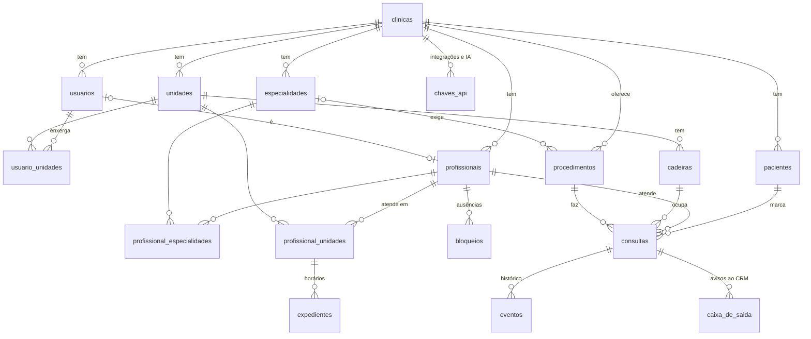

# Modelo de dados

- **Status:** aprovado em 2026-10-07, com as cinco decisões do fim como foram
  recomendadas. As migrações estão no código e **não foram aplicadas** em nenhum
  banco de verdade: a aplicação no projeto do CRM fica para o corte (fase 9), com o
  OK da equipe.
- **Onde está:** `src/infra/banco/esquema.ts` e as migrações em `drizzle/`, para o
  esquema `agenda` do Postgres do projeto do CRM ("Clinic Control")
  ([ADR 0001](adr/0001-app-proprio-com-a-arquitetura-do-crm.md)). O controle do que
  já rodou fica em `agenda.__drizzle_migrations`.
  - `0000_esquema_agenda`: gerada pelo Drizzle (tabelas, chaves, `check`, RLS).
  - `0001_regras_de_horario`: escrita à mão, com o que o Drizzle não descreve (as
    extensões, as restrições de exclusão e o gatilho do histórico).
- **Testes:** `testes/banco/migracoes.test.ts` aplica as migrações num Postgres
  dentro do processo (PGlite) e tenta quebrar cada regra desta página.

## Como este modelo foi feito

1. **Das consultas para as tabelas.** O que a agenda mais pede ao banco:
   - os horários livres de um dia: o expediente do profissional, as consultas e os
     bloqueios do dia e as cadeiras livres;
   - a agenda de um dia ou de uma semana, por unidade e por profissional;
   - achar o paciente pelo telefone (o agente) e pelo nome (a recepção);
   - a próxima consulta do paciente e o histórico dele (Paciente 360);
   - o que falta entregar ao CRM (a agenda não manda mensagem: fase 7c).
2. **Regras que o banco garante sozinho.** O que não pode quebrar fica numa
   restrição do banco, não só no código: dois pedidos ao mesmo tempo não conseguem
   marcar o mesmo horário.
3. **Do zero.** Nenhuma clínica usa a agenda em produção, então nada do banco antigo
   migra. O que muda em relação a ele está em "Do banco antigo para o novo".

## Visão geral

## Regras garantidas pelo banco

| Regra | Como |
|---|---|
| O profissional não tem duas consultas no mesmo horário | restrição de exclusão (`btree_gist`) sobre o profissional e o intervalo `[início, fim)`, só para as consultas que ocupam horário |
| A cadeira não tem duas consultas no mesmo horário | a mesma restrição, sobre a cadeira |
| O paciente não tem duas consultas no mesmo horário | a mesma restrição, sobre o paciente (decisão **D5**) |
| O profissional não tem dois expedientes que se cruzam no mesmo dia da semana, em nenhuma unidade | restrição de exclusão sobre o profissional, o dia e o intervalo de horas |
| Tudo da mesma clínica: consulta, paciente, profissional, cadeira, procedimento, unidade | chaves estrangeiras compostas com `clinica_id` |
| A cadeira da consulta é da unidade da consulta | chave estrangeira composta `(clinica_id, unidade_id, cadeira_id)` |
| O expediente é de uma unidade onde o profissional atende | chave estrangeira para `profissional_unidades` |
| Nome de unidade, especialidade e procedimento não repete na clínica; nome de cadeira não repete na unidade | índices únicos sobre `lower(nome)` |
| Um usuário é no máximo um profissional | índice único parcial em `profissionais (clinica_id, usuario_id)` |
| Fim depois do início (consulta, bloqueio, expediente); duração do procedimento entre 5 minutos e 8 horas | `check` |
| Consulta cancelada sempre com a data do cancelamento, e só ela | `check` |
| Valores de lista fechada (status, tipo de bloqueio, tipo de evento, destino e situação dos avisos...) | `check` a partir de `src/compartilhado/vocabulario.ts` |
| Histórico só com inserção | gatilho que recusa alterar, apagar e esvaziar `eventos` |
| Ninguém além do nosso servidor lê ou grava | RLS ligado sem nenhuma política, e o esquema fora da API REST do Supabase |

## Clínica e acesso

**`clinicas`**: cada clínica que usa a agenda.

| Coluna | Tipo | Observação |
|---|---|---|
| `id` | uuid | chave |
| `company_id` | uuid, único | a conta na plataforma (o `{{companyId}}` da URL do item de menu); é também o `X-Clinica` nas chamadas ao CRM |
| `nome`, `ativa` | | |
| `fuso_horario` | text | `America/Sao_Paulo` por padrão; os expedientes e os horários livres são calculados nele |
| `cadencia_minutos` | integer | de quanto em quanto tempo a grade oferece um início: 5, 10, 15, 20, 30 ou 60; padrão 30. A duração vem do procedimento |
| `ligada_ao_crm` | boolean | só manda avisos ao CRM quando ligada; padrão não |
| `crm_webhook_id`, `crm_webhook_segredo_cifrado` | text | o webhook que a agenda cadastra no CRM ao ligar a clínica, e o segredo dele, cifrado (fase 7b) |
| `procedimento_das_vindas_id` | uuid | o procedimento da consulta que o CRM marca fora da agenda; sem ele, ela espera a recepção |

A agenda não guarda o token da plataforma nem os modelos de mensagem: a
confirmação e o lembrete saem pelo CRM, pela data do card, e a conversa com o
paciente o CRM acha pelo card (fase 7c; a migração `0003` tirou as colunas).
| `criado_em`, `atualizado_em` | | |

**`usuarios`**: as pessoas da clínica que abrem a agenda pelo item de menu, com os
papéis `gestor`, `recepcao` e `dentista` (uma pessoa pode ter mais de um; pelo menos
um). O `usuario_plataforma_id` é o `{{userId}}`: o id do usuário, nunca o do
atendente, como no CRM.

| Coluna | Observação |
|---|---|
| `usuario_plataforma_id` | único na clínica |
| `nome`, `email`, `ativo` | |
| `gestor`, `recepcao`, `dentista` | boolean |

| Papel | O que faz |
|---|---|
| Gestor | tudo, inclusive as configurações e as chaves |
| Recepção | agenda, remarca, cancela, marca falta e chegada, cadastra paciente |
| Dentista | vê a agenda dele e marca chegada e atendimento; não cancela nem marca falta |

**`usuario_unidades`**: as unidades que cada usuário enxerga. Sem nenhuma linha, ele
vê todas; o gestor sempre vê todas. Igual ao CRM.

**`chaves_api`**: as chaves do agente de IA e das integrações. A chave entra pelo
hash e fica guardada cifrada, para a equipe copiar de novo, como no CRM. Diferente
do CRM, **cada chave é de uma clínica só**: o agente e os fluxos do n8n já são por
clínica.

| Coluna | Observação |
|---|---|
| `nome`, `tipo` | `ia` ou `integracao`; aparece no histórico |
| `prefixo`, `hash` (único), `chave_cifrada` | |
| `pode_escrever` | a chave só de leitura não marca nem muda consulta |
| `ultimo_uso_em`, `revogada_em` | |

## A clínica por dentro

**`unidades`**: nome (não repete na clínica), endereço, telefone e `ativa`. Toda
clínica tem pelo menos uma: a consulta acontece numa unidade, numa cadeira dela.
Não se apaga, se desativa. `crm_unidade_id` guarda a unidade correspondente no CRM,
para o card nascer nela; vazio manda o card para "Sem unidade".

**`cadeiras`**: os consultórios de cada unidade, com nome (não repete na unidade) e
`ativa`.

**`especialidades`**: a lista da clínica (Ortodontia, Implante...), com nome que não
repete (decisão **D2**). Hoje é texto livre, e "ortodontia" e "Ortodontia" viram
duas.

**`procedimentos`**: nome, `duracao_minutos` (de 5 a 480), cor, `ativo` e a
`especialidade_id` exigida (vazia: qualquer profissional faz). A duração do
procedimento é a da consulta, e quem agenda pode mudar a da consulta.

## Profissionais

**`profissionais`**: quem atende. Nome, CRO, cor na agenda e `ativo`. O
`usuario_id` liga ao usuário quando o profissional entra na agenda pela plataforma;
o profissional sem usuário existe e recebe consultas do mesmo jeito.

**`profissional_especialidades`**: as especialidades de cada profissional. O
procedimento que exige uma especialidade só aparece para quem a tem.

**`profissional_unidades`**: onde o profissional atende, com a `prioridade` dele
naquela unidade (menor vem primeiro). É a nota que o agente usa para recomendar,
depois de quem já atendeu o paciente.

**`expedientes`**: os horários de trabalho, no fuso da clínica.

| Coluna | Observação |
|---|---|
| `profissional_id`, `unidade_id` | precisa existir em `profissional_unidades` |
| `dia_semana` | 0 (domingo) a 6 (sábado) |
| `inicio`, `fim` | hora do dia; o fim depois do início |

Pode haver mais de um intervalo no mesmo dia (manhã e tarde, ou duas unidades). Dois
intervalos do mesmo profissional no mesmo dia nunca se cruzam, nem em unidades
diferentes.

**`bloqueios`**: quando o profissional não atende fora do padrão (férias, reunião,
horário reservado).

| Coluna | Observação |
|---|---|
| `profissional_id` | |
| `unidade_id` | onde, só para mostrar; o bloqueio tira o profissional de todas as unidades, como na agenda antiga |
| `inicio`, `fim` | instantes, com fuso |
| `tipo` | `ausencia`, `intervalo`, `reuniao` ou `reservado` |
| `motivo`, `criado_por_id` | |

Sem repetição automática: o `rrule` de hoje nunca foi lido por nada. O intervalo de
todo dia se faz partindo o expediente.

## Pacientes e consultas

**`pacientes`**: nome, telefone em E.164 (como no CRM, com o nono dígito no celular
antigo), e-mail, nascimento e observações. `contato_plataforma_id` guarda o contato
na plataforma, quando achado. Índice por `(clinica_id, telefone)`; a busca pelo nome
ignora acento, numa consulta dedicada. O telefone pode repetir na clínica, porque a
família usa o mesmo número (decisão **D1**).

**`consultas`**:

| Coluna | Observação |
|---|---|
| `unidade_id`, `cadeira_id`, `profissional_id`, `paciente_id`, `procedimento_id` | todos da mesma clínica; a cadeira, da unidade |
| `inicio`, `fim` | instantes, com fuso; a duração é a diferença |
| `status` | `agendada`, `confirmada`, `em_atendimento`, `concluida`, `cancelada` ou `faltou` |
| `observacoes` | |
| `criada_por_tipo`, `criada_por_id` | `usuario`, `ia` ou `integracao`, e quem foi |
| `cancelada_em`, `motivo_cancelamento` | só na cancelada |
| `crm_card_id` | o card do paciente no CRM, que o worker guarda na primeira entrega |
| `versao` | controle de edição simultânea, como o card do CRM |
| `criado_em`, `atualizado_em` | |

- **Ocupam o horário** as consultas `agendada`, `confirmada`, `em_atendimento` e
  `concluida`. A cancelada e a falta liberam: é a elas que as restrições de exclusão
  não se aplicam.
- **O ciclo:** `agendada` → `confirmada` → `em_atendimento` → `concluida`; a
  agendada ou confirmada pode virar `cancelada` ou `faltou`. Quem pode cada passo
  é regra do domínio (fase 4).
- **Remarcar** muda o início e o fim da mesma consulta, com o evento no histórico.

## Histórico e caixa de saída

**`eventos`**: o histórico da agenda. Só aceita inserção.

| Coluna | Observação |
|---|---|
| `id` | sequencial |
| `consulta_id`, `paciente_id` | pelo menos um |
| `tipo` | `consulta_criada`, `consulta_remarcada`, `status_mudou`, `consulta_alterada`, `paciente_criado`, `paciente_alterado` |
| `dados` | o que mudou: campo, antes, depois, motivo |
| `ator_tipo`, `ator_id` | `usuario`, `ia`, `integracao` ou `sistema`, e quem foi |
| `ocorrido_em` | |

**`caixa_de_saida`**: o que a agenda precisa avisar ao CRM. O
caso de uso grava o aviso **na mesma transação** da consulta, e o worker entrega,
com novas tentativas. Se a consulta foi gravada, o aviso sai.

| Coluna | Observação |
|---|---|
| `id` | sequencial: a ordem de entrega |
| `destino` | `crm` (o único desde a fase 7c) |
| `tipo` | `consulta_criada`, `consulta_remarcada`, `consulta_cancelada`, `paciente_faltou`, `paciente_compareceu` |
| `consulta_id`, `paciente_id` | |
| `dados` | o que a entrega precisa, copiado na hora (telefone, nome, data, unidade) |
| `situacao` | `pendente`, `concluido` ou `falhou` (desistiu depois das tentativas) |
| `tentativas`, `proxima_tentativa_em`, `ultimo_erro` | |
| `resultado` | o que voltou (o id do card, ou por que a entrega não mexeu nele) |
| `criado_em`, `concluido_em` | |

- **Ordem por consulta:** o worker só entrega o próximo aviso de uma consulta
  depois que o anterior terminou. Uma consulta criada e cancelada logo depois chega
  ao CRM nessa ordem.
- **Repetir não estraga:** a API do CRM ignora o movimento repetido.
- Substitui os efeitos que hoje rodam soltos depois da resposta e se perdem quando
  algo cai no meio.

## Do banco antigo para o novo

| Hoje (`public`) | No esquema `agenda` |
|---|---|
| `accounts` | `clinicas`, com o `company_id`; saem `slug` e `theme_config` (sem uso) |
| `account_integrations` | colunas de `clinicas`; saem `panel_id` e `step_mappings` |
| `units` | `unidades`, mais `crm_unidade_id` |
| `users` | `usuarios`, com os papéis como colunas; as unidades em `usuario_unidades` |
| `dentists` | `profissionais`, com nome próprio e usuário opcional |
| `dentist_units` | `profissional_unidades` |
| `dentist_schedules` | `expedientes`, com mais de um intervalo por dia |
| `dentist_priorities` | **sai**: nada lia a tabela, e a prioridade que o agente usa já é a de `dentist_units` |
| `schedule_blocks` | `bloqueios`, sem `rrule` e com a unidade opcional |
| `chairs` | `cadeiras` |
| `procedures` | `procedimentos`, com a especialidade da lista |
| `patients` | `pacientes`; saem `helena_lead_id` (nunca preenchido) e o telefone em duas colunas |
| `appointments` | `consultas`; saem `duration_minutes` (é a diferença), `closed_*` (o valor fechado é do CRM), `confirmation_status` e `last_sync_status` (nunca gravados); entram `versao` e `crm_card_id` |
| `ai_api_keys` | `chaves_api`, com o tipo |
| `helena_*`, `step_mappings`, `tag_links`, `sync_outbox`, `sync_log`, `webhook_events` | **saem**: o card mora no CRM, e a entrega vira `caixa_de_saida` |
| (não havia) | `especialidades`, `eventos`, `caixa_de_saida` |

## Decisões da equipe (2026-10-07)

Aprovadas como recomendadas.

| | Pergunta | Decisão |
|---|---|---|
| **D1** | O telefone do paciente é único na clínica (como hoje), ou vários pacientes podem ter o mesmo número? | **Vários.** A mãe marca para o filho com o número dela, e hoje isso grava a consulta no cadastro da mãe. Com vários, o agente confere pelo nome e pergunta quando houver dúvida. |
| **D2** | Especialidades numa lista da clínica, ou texto livre como hoje? | **Lista.** O filtro "o procedimento exige especialidade" depende do texto bater igual. |
| **D3** | O token da plataforma: uma cópia cifrada na agenda, ou esperar o cadastro único (Etapa 15), que hoje deixa a agenda de fora? | ~~Cópia cifrada agora~~. **Superada na fase 7c (2026-10-15):** a agenda não manda mensagem nem guarda o token; o CRM manda o lembrete e acha a conversa. |
| **D4** | A chamada ao CRM: uma chave da agenda (tipo integração) que alcança as clínicas dela, no `.env`, com o `X-Clinica`; ou uma chave por clínica no banco? | **Uma chave da agenda**, com escopo nas clínicas que usam a agenda. Menos coisa para configurar em cada clínica. |
| **D5** | O banco recusa o mesmo paciente em duas consultas ao mesmo tempo? | **Sim.** Hoje nada impede. |
